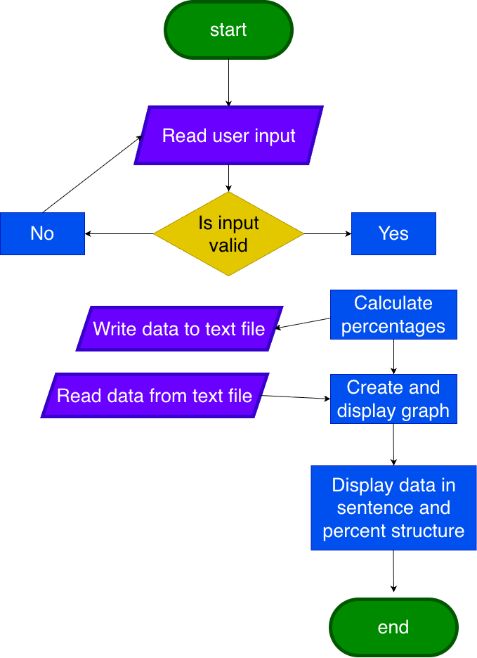

# cs193-final-project

Calculates and displays statistics representing the inputted amount of music listened to.

## The Problem

I would like to manage the amount of time I spend listening to music, or visualize it in a way that creates an interesting perspective on how often I spend time listening to it using stats given to me by my Spotify listening history.

## How It Works

When the program is run it will ask the user to input the amount of minutes they have listened to music in a week timespan, the amount of minutes coming from the user's music listening platform of choice. Then once the input is properly validated, it will continue to calculating the percent of that week spent listening to music. Then writing this information to a text file. After that, the text file is read and a graph is created based on the user's saved data and the information calculated is displayed.

## Tech Stack

- **Language:** Java.
- **Libraries:** time, JFreeChart.
- **External tools:** Spotify, VS Code.

## Roadmap

- [ ] Data sorted by week in chronological order.
- [ ] Time elapsed in current week listening is displayed and changes per run.
- [ ] Calculate the total time elapsed listening to music over all weeks in the data.

## Author

Ethan Perkins, [GitHub](https://github.com/perkieth000)